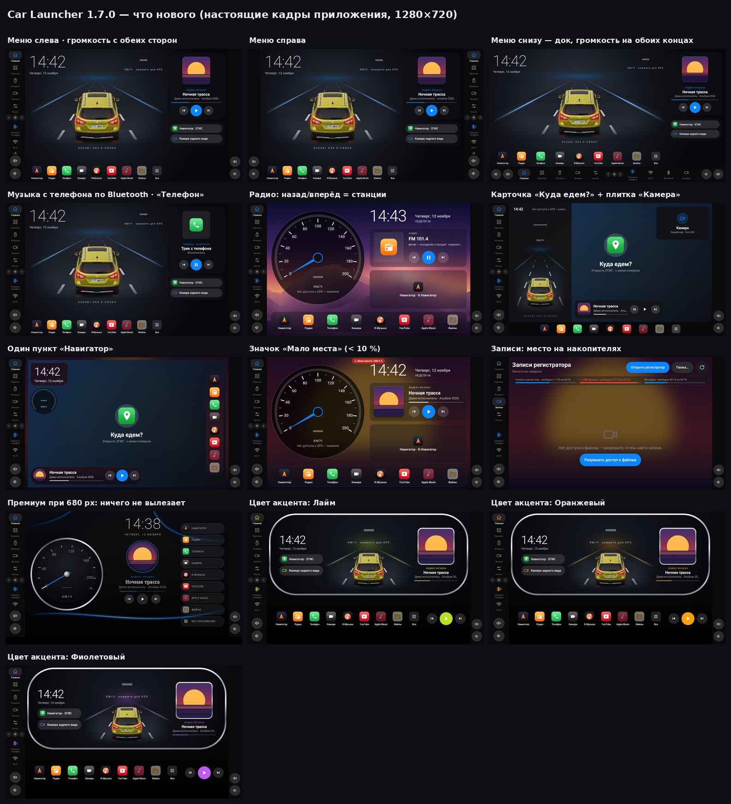

# Car Launcher

Свой лаунчер для магнитолы TEYES (FYT, Android 10, 1280×720) в Suzuki SX4 S-Cross. Kotlin, без AndroidX, minSdk 26 / targetSdk 29.



## Что умеет
- 15+ раскладок главного экрана (день/ночь), SX4 на дороге, госномер KZ.
- Музыка: следит за всеми плеерами, берёт запущенный последним и играющий; телефон по Bluetooth («Телефон»), радио магнитолы (⏮ ⏭ = станции).
- Один пункт «Навигатор» (2ГИС / Яндекс Навигатор), мини-плеер поверх.
- Меню слева / справа / снизу (док), настраиваемое; кнопки громкости всегда на экране (по умолчанию с обеих сторон).
- Записи регистратора и «Флешка» с местом на накопителях, предупреждение «Мало места».
- Обновления через GitHub Releases этого репозитория (Настройки → «Проверить обновления»).

## Безопасность
Кнопки руля не перехватываются, MCU и системные настройки не меняются. Откат: Настройки → «Вернуть штатный экран».

## Сборка
```
gradle assembleRelease      # нужен keystore/carlauncher.jks + keystore/signing.properties (НЕ в репозитории)
gradle testReleaseUnitTest  # Robolectric-тесты и рендеры в preview/
```
Подпись: `keystore/signing.properties` (storeFile, storePassword, keyAlias, keyPassword) или переменные окружения
`CL_STORE_FILE`, `CL_STORE_PASSWORD`, `CL_KEY_ALIAS`, `CL_KEY_PASSWORD`. Обновление ставится поверх, только если подписано тем же ключом.

## Релизы
Каждый релиз — тег `vX.Y.Z`, APK как asset, в тексте строки `versionCode: N` и `sha256: …` (лаунчер проверяет контрольную сумму, пакет и подпись перед установкой).

Ревизия штатных приложений TEYES: [APPS-RU.md](APPS-RU.md).
